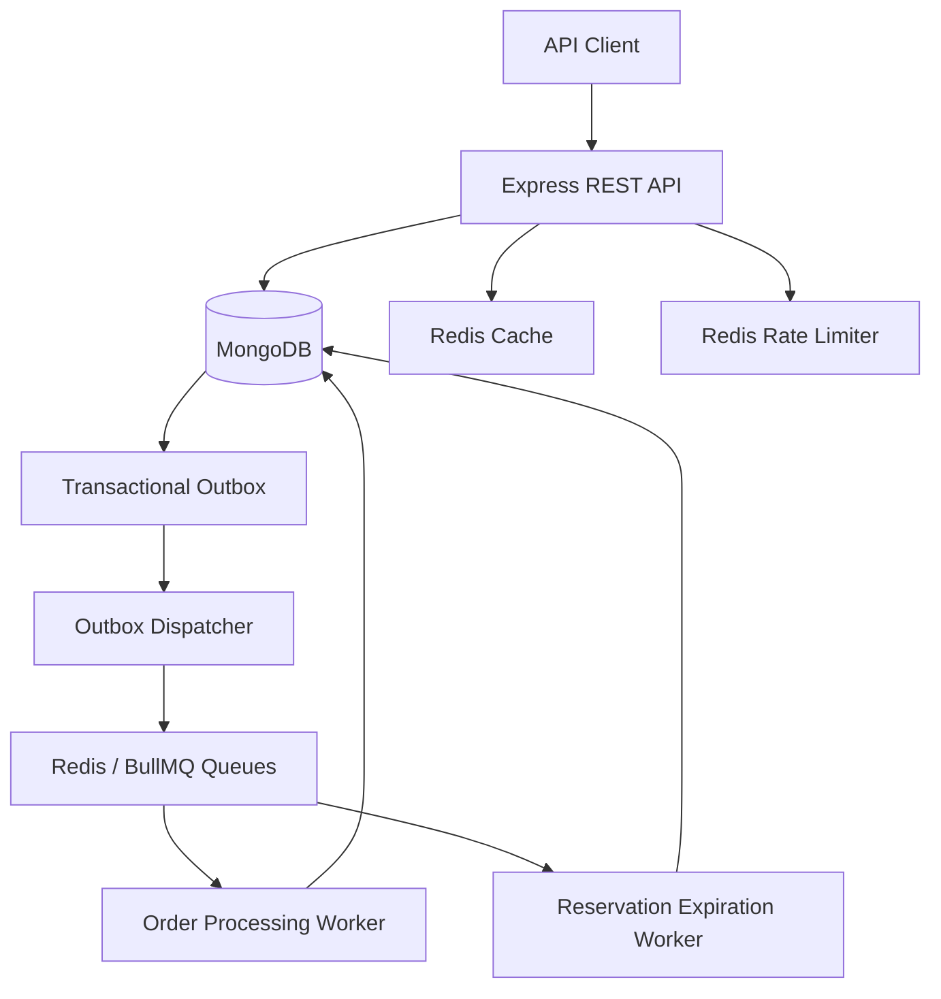

# FlashStock — High-Concurrency Inventory & Order Processing Engine

FlashStock is a backend engineering project designed to handle concurrent inventory reservations and reliable asynchronous order processing.

It uses atomic MongoDB updates and transactions to protect inventory consistency, idempotency to handle duplicate requests, and a transactional outbox with BullMQ to coordinate background jobs.

## Key Features

- **Concurrency-safe inventory reservations:** Atomic stock updates prevent reservations from exceeding available inventory.
- **Idempotent APIs:** Repeated requests with the same idempotency key return the existing reservation or order when the request data matches.
- **MongoDB transactions:** Reservation creation, inventory updates, and outbox-event creation are transactionally coordinated.
- **Transactional outbox:** Persistent events are dispatched to background queues, with leases and retry handling.
- **Asynchronous processing:** BullMQ workers handle order processing and reservation expiration.
- **Failure recovery:** Includes retry mechanisms, duplicate-job handling, stale-event recovery, and order-processing recovery.
- **Redis caching and rate limiting:** Redis supports product-list caching, cache invalidation, rate limiting, and BullMQ.
- **Input validation:** Zod schemas validate request bodies, identifiers, quantities, and idempotency keys.
- **Operational endpoints:** Liveness and readiness checks support service monitoring.
- **Containerization:** Docker and Docker Compose provide a reproducible service setup.

## Technology Stack

| Technology | Purpose |
|---|---|
| JavaScript (CommonJS) | Application language and module system |
| Node.js | Runtime |
| Express.js | REST API |
| MongoDB and Mongoose | Persistence, schemas, indexes, and transactions |
| Redis | Caching, rate limiting, and queue infrastructure |
| BullMQ | Background jobs, retries, and recovery |
| Zod | Request validation |
| Docker and Docker Compose | Containerization and service orchestration |
| Node.js Test Runner | Automated unit and integration tests |
| k6 | HTTP load and concurrency testing |

## Architecture



### Inventory reservation flow

1. A client submits a reservation request with an `Idempotency-Key`.
2. The inventory service atomically decrements available stock and increments reserved stock.
3. A reservation and its outbox event are created within the MongoDB transaction.
4. The API returns the reservation result.
5. The outbox dispatcher publishes the expiration event to BullMQ.
6. A background worker handles expiration, releasing reserved stock when appropriate.

### Order processing flow

1. A client creates an order for a pending reservation.
2. The order and its processing event are persisted transactionally.
3. The outbox dispatcher publishes the event to BullMQ.
4. The order worker claims the order through an atomic state transition.
5. The worker confirms or releases the reservation according to the mock payment outcome.
6. Repeated processing of a completed order is skipped.

The current payment implementation is a local mock. A real payment provider is not integrated.

## Prerequisites

- Node.js 24 or a compatible supported Node.js release.
- npm.
- A MongoDB deployment that supports transactions, such as a replica set.
- Redis.
- Docker and Docker Compose if using the containerized deployment.

## Local Development Setup

### 1. Enter the server directory

```powershell
cd server
```

### 2. Install dependencies

```powershell
npm ci
```

### 3. Create your local environment file

```powershell
Copy-Item .env.example .env
```

Edit `.env` and replace the `MONGO_URI` placeholder with your own MongoDB connection string.

Set `REDIS_URL` to the Redis instance available to your local Node.js processes. Keep real credentials in `.env`; never commit that file.

The integration tests explicitly use a database named `flashstock_test`. Ensure the configured MongoDB user has permission to access that database.

### 4. Start the application

Make sure MongoDB and Redis are available, then start the API:

```powershell
npm run dev
```

Start each background process in a separate terminal from the `server` directory:

```powershell
npm run start:outbox
```

```powershell
npm run start:reservation-worker
```

```powershell
npm run start:order-worker
```

For local order creation with mock payments, use development settings with `PAYMENT_MODE=mock`.

## Docker Compose

From the `server` directory, configure `.env` and start the services:

```powershell
docker compose config --quiet
docker compose up --build -d
```

Inspect running services:

```powershell
docker compose ps
```

View logs:

```powershell
docker compose logs -f api
```

Stop the services:

```powershell
docker compose down
```

The Compose configuration runs the API and workers with `NODE_ENV=production`. The order API deliberately disables mock payments in production mode. Configure a real payment provider before enabling production order creation.

The Redis data volume is retained when Compose is brought down unless the volume is explicitly removed.

## Environment Variables

See `server/.env.example` for the complete list of configuration names and safe placeholder values.

| Variable | Purpose |
|---|---|
| `NODE_ENV` | Application environment |
| `PORT` | HTTP server port |
| `MONGO_URI` | MongoDB connection string |
| `MONGO_DB_NAME` | Optional MongoDB database override |
| `REDIS_URL` | Redis connection URL |
| `RESERVATION_TTL_MS` | Reservation lifetime in milliseconds |
| `ORDER_PROCESSING_LEASE_MS` | Order-processing lease duration |
| `ORDER_PROCESSING_QUEUE_NAME` | Order worker queue name; defaults to the application queue |
| `PRODUCT_READ_RATE_LIMIT_MAX` | Product-list requests allowed per rate-limit window |
| `PAYMENT_MODE` | Local mock-payment mode setting |
| `MONGO_COMMAND_MONITORING` | Optional MongoDB command diagnostics |
| `MONGO_POOL_MONITORING` | Optional MongoDB connection-pool diagnostics |
| `RESERVATION_PERFORMANCE_LOGS` | Optional reservation performance logs |

Do not commit `.env`, database credentials, Redis credentials, or other secrets.

## API Reference

The default local API address is `http://localhost:5000`.

### Health endpoints

| Method | Endpoint | Purpose |
|---|---|---|
| GET | `/health/live` | Checks whether the API process is alive |
| GET | `/health/ready` | Checks MongoDB and Redis readiness |

### Products

#### Create a product

`POST /api/products`

Example request:

```json
{
  "name": "Test Product",
  "sku": "TEST-PRODUCT-001",
  "description": "A sample inventory product",
  "price": 100,
  "initialStock": 10
}
```

The product validator requires a name of 2–120 characters, a valid SKU, a nonnegative price, and a nonnegative integer stock quantity.

Successful creation returns HTTP `201`. A duplicate SKU returns HTTP `409`.

#### List products

`GET /api/products?page=1&limit=10`

Both `page` and `limit` must be positive integers. The maximum page size is 100.

The response contains product data and pagination metadata. Only active products are returned.

### Reservations

#### Reserve inventory

`POST /api/products/:productId/reservations`

Header:

```text
Idempotency-Key: reservation-demo-001
```

Request body:

```json
{
  "quantity": 1
}
```

A successful new reservation returns HTTP `201`. An identical replay returns HTTP `200`. Invalid requests return HTTP `400`, and insufficient stock returns HTTP `409`.

An idempotency key must be between 8 and 128 characters and use the supported character set.

#### Confirm a reservation

`POST /api/reservations/:reservationId/confirm`

Confirms a pending, unexpired reservation and moves its units from reserved stock to sold stock.

#### Release a reservation

`POST /api/reservations/:reservationId/release`

Releases a pending reservation and returns its units to available inventory. Repeated release operations do not restore stock twice.

Both action endpoints return HTTP `200` on successful processing or replay.

### Orders

#### Create an order

`POST /api/orders`

Header:

```text
Idempotency-Key: order-demo-001
```

Request body:

```json
{
  "reservationId": "507f1f77bcf86cd799439011",
  "testPaymentOutcome": "success"
}
```

`testPaymentOutcome` is optional and accepts `success` or `failure`. It is available only for the local mock-payment implementation.

A newly accepted order returns HTTP `202`. An idempotent replay returns HTTP `200`.

#### Retrieve an order

`GET /api/orders/:orderId`

Returns the current persisted order, including its status and payment-attempt count.

Order statuses include:

- `payment_pending`
- `processing`
- `confirmed`
- `payment_failed`
- `cancelled`

## Testing

Run the unit tests:

```powershell
npm test
```

Run the integration tests:

```powershell
npm run test:integration
```

The unit tests cover request validation. Integration tests exercise the actual MongoDB-backed services and isolated BullMQ queues.

The integration suite requires MongoDB and Redis to be available. It uses the dedicated `flashstock_test` database and creates temporary queue names for queue tests. Do not configure test runs against a database containing important application data.

### Performance Testing

FlashStock includes [k6](https://k6.io/) scripts to test API response correctness, latency, and behavior under concurrent load.

**Test environment:** Local Windows development environment, Node.js API, MongoDB, Redis, and k6 v2.2.0. Results are from local runs and may vary with hardware, data, cache state, and configuration.

#### Recorded Results

| Metric | Product API Baseline | Product API Ramping Load |
|---|---:|---:|
| Test duration | 20 seconds | 35 seconds |
| Virtual users | 5 | Ramped up to 10 |
| Completed HTTP requests | 100 | 15,178 |
| Observed throughput | 4.81 requests/sec | 433.64 requests/sec |
| Average response time | 34.64 ms | 8.45 ms |
| P95 response time | 139.94 ms | 13.21 ms |
| Failed HTTP requests | 0% | 0% |
| Response checks passed | 100% | 100% |
| Configured thresholds | Passed | Passed |

#### How to Run the Tests

Run these commands from the `server` directory:

```bash
k6 run ./scripts/k6-products-baseline.js
k6 run ./scripts/k6-products-load.js
```

The baseline test uses five virtual users for 20 seconds. The ramping test increases concurrency over multiple stages, reaching a configured maximum of ten virtual users.

The tests validate HTTP status codes and product-list response structure, while enforcing thresholds for request failures and response latency.

**Rate-limit considerations:** The baseline was run with the normal product-read limit of 120 requests per minute. The ramping benchmark was run with a temporary local limit of 100,000 requests per minute to reduce rate-limit interference during testing. The normal limit was restored to 120 after the benchmark. The elevated value is for local benchmarking only and is not a production recommendation.

**Interpretation:** In these local runs, the product-list endpoint completed the tested requests without HTTP failures and met the configured latency and check-success thresholds. These results do not establish production capacity, sustained-load performance, or behavior under all failure scenarios.

### Verified test scenarios

- 20 distinct reservation requests against 5 available units: 5 succeed and 15 receive insufficient-stock responses.
- 20 concurrent requests with the same reservation idempotency key: 1 reservation and 19 replays.
- Sequential idempotency and conflicting request data.
- Duplicate and concurrent order-processing executions.
- Mock payment failure and reservation release.
- Recovery of stale order-processing claims.
- BullMQ retry behavior after intentional job failures.
- Recovery of a job after its worker process is killed.
- Execution of the actual order-processing worker against an isolated test queue.

The latest verified run completed **6 unit tests and 11 integration tests successfully**. These are local development results, not production reliability guarantees.

## Security and Production Limitations

- No authentication or authorization layer is currently documented in this implementation.
- CORS is configured permissively for development and should be restricted before public deployment.
- Mock payments are not a substitute for a payment provider.
- Payment-provider idempotency, external transaction reconciliation, production load capacity, and multi-process payment recovery require additional validation.
- MongoDB and Redis should be deployed with appropriate access controls and network restrictions.

## Project Structure

```text
server/
├── src/
│   ├── config/
│   ├── controllers/
│   ├── middleware/
│   ├── models/
│   ├── queues/
│   ├── routes/
│   ├── services/
│   ├── validators/
│   ├── workers/
│   └── server.js
├── scripts/
├── test/
│   ├── unit/
│   └── integration/
├── Dockerfile
├── compose.yaml
├── package.json
└── .env.example
```

## Future Improvements

- Add comprehensive HTTP API tests.
- Add continuous integration for unit and integration tests.
- Restrict CORS and introduce authentication and authorization.
- Integrate a real payment provider with provider-side idempotency.
- Add metrics and structured operational logging.
- Document reproducible load-test methodology and environment details.